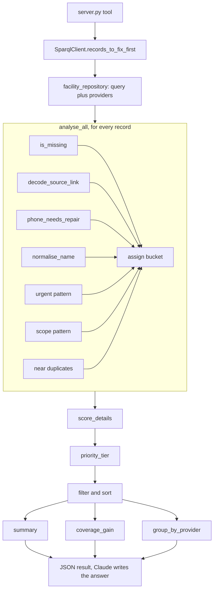

# records_to_fix_first

A tool for people who maintain the directory. It turns a pile of incomplete records into a short list of what to fix and who to ask.

## Why it is useful

Many records lack an address, phone number or opening hours, so people searching the directory cannot reach a service or know when it is open. Scrolling through blank cells does not scale: with 646 records in Berlin, nobody can tell which blanks matter.

This tool gives an overview instead:

- It ranks records so urgent services (addiction help, homelessness support, debt counselling) come first.
- It groups records by provider. One organisation with 26 incomplete facilities means one email, not 26 lookups.
- It spots records that can be filled from a source page already on file, and records that may not belong in the directory.
- It projects how much phone, email and opening hours coverage would rise if the top records were filled.

`check_completeness` says how many values are missing. This tool says what to do about it.

## Questions it answers

- Which Berlin facility records should we fix first?
- Which urgent services have missing data?
- Which providers should we contact first?
- Which records can we fix from a source page, without asking anyone?
- Which records may not belong in the directory?
- How much would coverage improve if we filled the top records?
- How is the priority calculated?

## Example Scenario: one email instead of 26 lookups

We want searchers to find real phone numbers, emails and opening hours, but most records lack them. Fixing blanks one record at a time is slow, and nobody knows where to start.

| | Without the tool | With the tool |
|---|---|---|
| Starting point | Open records one by one and hunt for sources | Ask "Which providers should we contact first?" |
| AWO Berlin Mitte | 26 facilities, each missing phone, email and hours: 26 separate lookups | One batch, 16 of 26 high priority: one email |
| SPI foundation | Same again for 11 more facilities | One batch, 6 of 11 high priority: one email |
| Total | 37 lookups | 2 emails |

Filling the AWO Berlin Mitte records alone is projected to lift Berlin phone coverage from 52.8% to 56.8%, email from 55.9% to 59.9% and opening hours from 16.4% to 20.4%. These are projections, not measured results.

The tool does not send email. It says whom to ask and which fields are missing, and Claude can draft the request from that.

## What it returns

A summary (counts by bucket and priority, urgent services, notes on broken phone numbers) plus either:

- ranked records, each with a priority tier, bucket, missing fields, reason, where to look and next step, or
- one batch per provider, for outreach.

It also returns a projected coverage gain. This is a projection, not a measured result. The numeric score is hidden unless `explain=true`.

## Parameters

| Parameter | Meaning |
|---|---|
| `city` | City to check, exact match. Default Berlin. |
| `provider` | Part of a provider name, or `unassigned`. |
| `n` | Records to return. Default 10. |
| `bucket` | Only one bucket, such as `scope_check`. |
| `group_by` | `provider` returns outreach batches. |
| `focus` | `urgent` keeps only urgent services. |
| `explain` | Adds the score and its breakdown. |

## Buckets

| Bucket | Meaning |
|---|---|
| `complete_key_field` | Useful record missing phone, email, hours or address. |
| `repair` | A value is present but broken. |
| `ask_provider` | The provider is known or guessed, so one request can fill the gap. |
| `enrich_from_source` | Almost empty, but a source page exists. |
| `scope_check` | May not be a service, such as a church body. |
| `junk_or_duplicate` | Near duplicate or broken entry. |
| `needs_research` | Almost empty, no lead. |
| `minor_gaps` | Small gaps only. |

## Priority

Score is the missing field weight, times a bonus factor, times a bucket multiplier. Bonuses: urgent service 0.4, known or suggested provider 0.2, homepage 0.3. Tiers: high at 18 or more, medium at 9 or more, low below that.

## How it works

Files: `sparql_queries/list_facility_quality_fields_by_city.rq` fetches the data, `src/fix_first.py` holds the ranking, and the tool docstring in `server.py` tells Claude how to answer.

## Tests

`tests/unit/test_fix_first.py` checks the ranking on a small fake dataset. `tests/unit/test_fix_first_sparql.py` runs the real query on `data/directory.ttl`. Run them with `python -m pytest -m "not llm and not api" --no-dashboard`.

## Live Berlin results

646 facilities: 63 high priority, 305 medium, 278 low. 143 are urgent services.

## Limits

- One city per call. Counts describe that city, not the whole directory.
- Coverage gains are projections.
- Provider matching uses names, so it can miss or misjudge a link.
- Scope and duplicate checks are rules of thumb. A person should confirm before removing anything.
- Adds `pandas` to `requirements.txt`.
